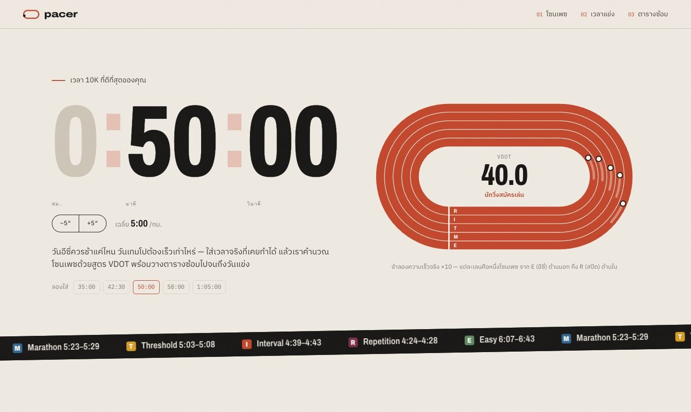
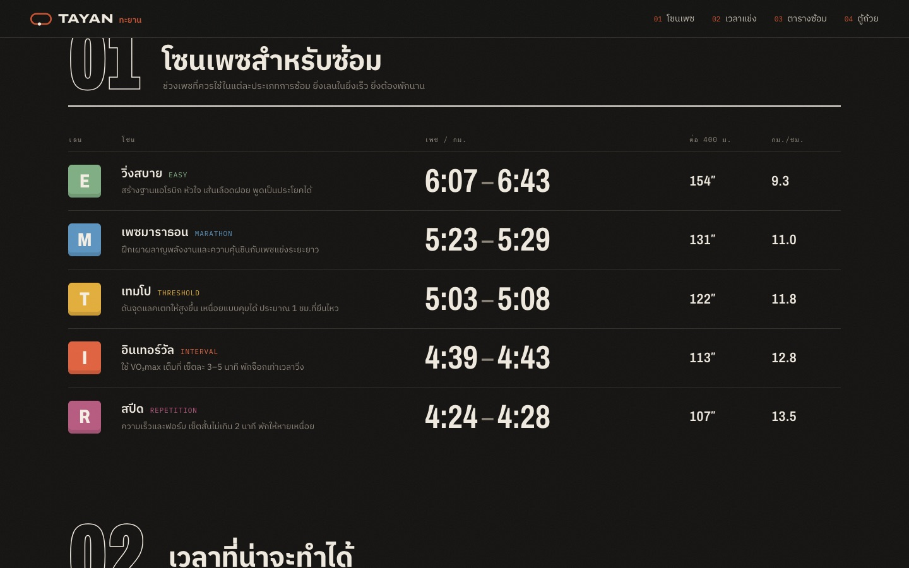
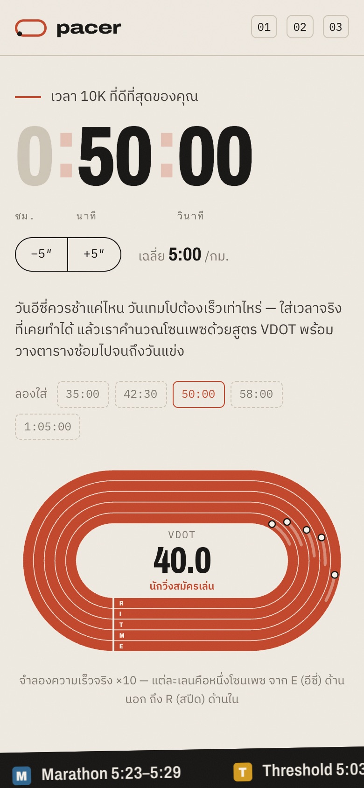
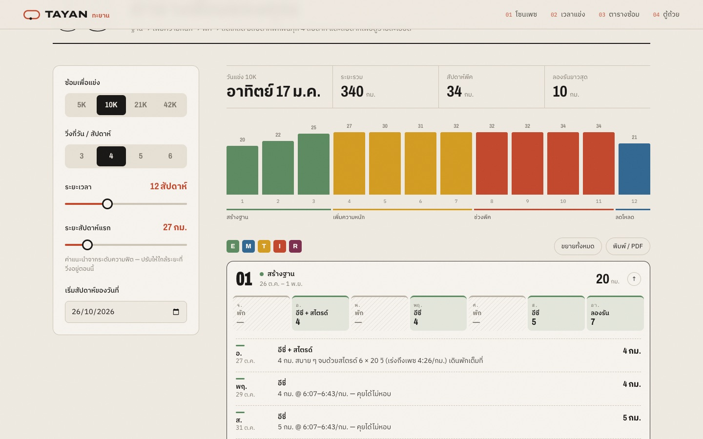
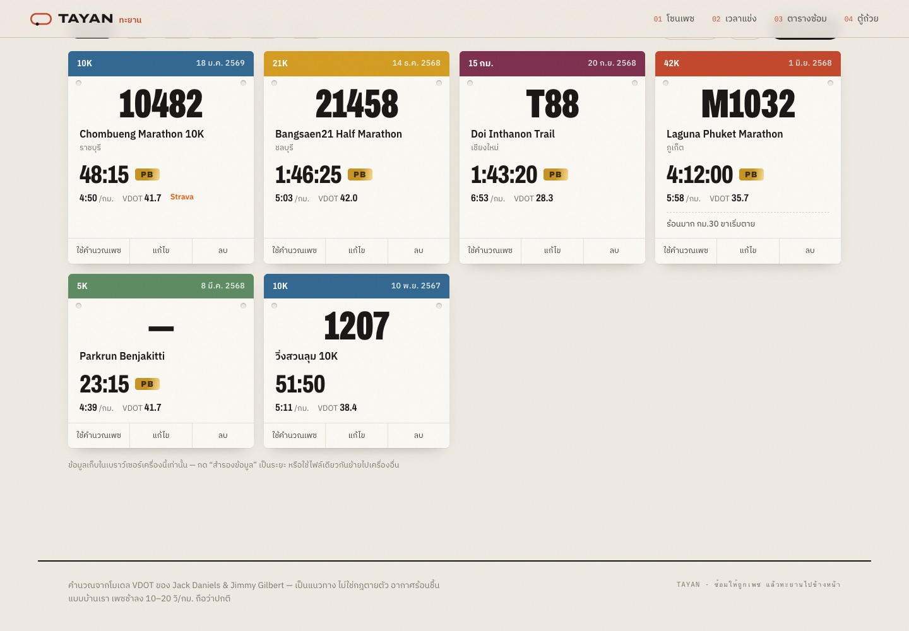

<div align="center">


# TAYAN <sub>ทะยาน</sub>

**ใส่เวลาที่ดีที่สุดของ 5K · 10K · ฮาล์ฟ · มาราธอน — ได้เพซซ้อมทุกโซนและตารางซ้อมถึงวันแข่ง**

Turn your best 5K, 10K, half or marathon time into training paces and a week-by-week plan.

[](LICENSE)
[](https://github.com/NTPxz/pacer/actions/workflows/pages.yml)


[**เปิดใช้งาน →**](https://ntpxz.github.io/pacer/)

<br />

<picture>
  <source media="(prefers-color-scheme: dark)" srcset="docs/hero-dark.jpg" />
  
</picture>

</div>

---

## ทำอะไรได้บ้าง

| | |
|---|---|
| **โซนเพซ 5 ระดับ** | Easy · Marathon · Threshold · Interval · Repetition พร้อมเวลาต่อ 400 ม. และ กม./ชม. |
| **คำนวณจากระยะไหนก็ได้** | เลือกระยะ 5K / 10K / 21K / 42K แล้วใส่เวลา สลับระยะได้ทันทีโดยความฟิตเท่าเดิม |
| **คาดการณ์เวลาแข่ง** | 5K, 10K, ฮาล์ฟมาราธอน, มาราธอน จากความฟิตปัจจุบัน |
| **ตารางซ้อมอัตโนมัติ** | 8–20 สัปดาห์ · เป้า 5K–42K · วิ่ง 3–6 วัน/สัปดาห์ · ทุกวันมีเซ็ต ระยะ และเพซกำกับ |
| **ตู้ถ้วยรางวัล** | บันทึกสนามที่เคยแข่ง (ชื่อ วันที่ ระยะ เวลา เลขบิบ สถานที่ โน้ต) พร้อมรูปความทรงจำสูงสุด 8 รูป/รายการ เลือกใส่ stat ติดรูปได้ 3 แบบ (โปสเตอร์ · สติกเกอร์ · เส้นบาง) แล้วบันทึกหรือแชร์ไป IG/LINE ได้ทันที หา PB ของแต่ละระยะให้อัตโนมัติ กราฟพัฒนาการ VDOT และกดใช้ผลแข่งไหนเป็นฐานคำนวณเพซก็ได้ · สำรอง/นำเข้าเป็นไฟล์ JSON |
| **ลู่วิ่งเคลื่อนไหว** | นักวิ่ง 5 คนในหน้าแรกวิ่งด้วยความเร็วจริงของแต่ละโซน (เร่ง ×10) |
| **ใช้ได้ทุกจอ** | มือถือ / เดสก์ท็อป · โหมดมืดตามระบบ · พิมพ์หรือบันทึก PDF ได้ |
| **ไม่ต้องสมัคร** | ทำงานในเบราว์เซอร์ล้วน ไม่มีเซิร์ฟเวอร์ ไม่เก็บข้อมูลออกนอกเครื่อง |

<table>
  <tr>
    <td width="62%"></td>
    <td rowspan="2"></td>
  </tr>
  <tr>
    <td></td>
  </tr>
  <tr>
    <td colspan="2"></td>
  </tr>
</table>

## คำนวณยังไง

ใช้โมเดล **VDOT** ของ Jack Daniels & Jimmy Gilbert จากหนังสือ *Daniels' Running Formula*

```
VO₂(v)   = −4.60 + 0.182258·v + 0.000104·v²                               v = ม./นาที
%max(t)  = 0.8 + 0.1894393·e^(−0.012778·t) + 0.2989558·e^(−0.1932605·t)   t = นาที
VDOT     = VO₂(v) / %max(t)
```

จาก VDOT ย้อนกลับไปหาความเร็วของแต่ละโซน:

| โซน | ความเข้มข้น | ใช้ทำอะไร |
|---|---|---|
| **E** Easy | 62–70% VDOT | วิ่งสบาย ลองรัน สร้างฐานแอโรบิก |
| **M** Marathon | เพซมาราธอนที่คาดการณ์ได้ | ฝึกเพซแข่งระยะยาว |
| **T** Threshold | ~88% VDOT | เทมโป / ครูซอินเทอร์วัล |
| **I** Interval | ~97.5% VDOT | เซ็ต 3–5 นาทีที่ VO₂max |
| **R** Repetition | I − ~6 วิ/400 ม. | ความเร็วและฟอร์ม |

ผลลัพธ์ตรงกับตาราง VDOT ต้นฉบับ เช่น 10K **50:00** → VDOT **40.0**, เทมโป **5:03–5:08/กม.**, อินเทอร์วัล **113″/400 ม.**

### โครงสร้างตารางซ้อม

```
สร้างฐาน ──▶ เพิ่มความหนัก ──▶ ช่วงพีค ──▶ ลดโหลด ──▶ วันแข่ง
  ~30%          ~35%           ที่เหลือ     1–2 สัปดาห์
```

- **ระยะรายสัปดาห์** ค่อย ๆ เพิ่มจากสัปดาห์แรกถึงพีค (×1.3 สำหรับ 5K ถึง ×1.55 สำหรับมาราธอน) และลดลง 20% ทุกสัปดาห์ที่ 4 เพื่อพักฟื้น
- **วันคุณภาพ 2 วัน/สัปดาห์** เลือกตามช่วงและระยะเป้าหมาย เช่น 10K: สปีด + เทมโปในช่วงเพิ่มความหนัก → อินเทอร์วัล + เทมโปในช่วงพีค
- **จำกัดปริมาณตามหลัก Daniels** T ≤ 10%, I ≤ 8%, R ≤ 5% ของระยะรายสัปดาห์ ลองรันไม่เกิน ~30%
- **เป้าวันแข่งเร็วกว่าความฟิตตอนนี้** คาดการณ์ VDOT ที่จะขึ้นหลังซ้อมครบ (ราว 1 จุดต่อ 4 สัปดาห์สำหรับ VDOT < 40 และน้อยลงเมื่อฟิตขึ้น) เลือกระดับได้ ชิล ๆ ×0.5 · ปกติ · ท้าทาย ×1.5
- **เพซซ้อมขยับตามช่วง** สร้างฐานใช้ความฟิตปัจจุบัน → เพิ่มความหนัก 35% → พีค 70% → ลดโหลด/วันแข่ง 100% ของ VDOT ที่คาดว่าจะเพิ่ม
- สัปดาห์สุดท้ายจบด้วยวันแข่งพร้อมเวลาเป้าหมายและเพซเฉลี่ย

### ตารางปรับตามการซ้อมจริง

การ์ด **วันนี้** ให้เช็กอิน "แบต" ก่อนวิ่ง (หมดแรง → พร้อมลุย) และบันทึกหลังวิ่ง (ทำครบ / บางส่วน / ขาดซ้อม + ระยะจริง + ความรู้สึก) แตะวันไหนในการ์ดสัปดาห์ก็บันทึกย้อนหลังได้ ตารางจะปรับเองและบอกเหตุผลทุกครั้ง:

| สิ่งที่เกิดขึ้น | ตารางปรับยังไง |
|---|---|
| เช็กอินว่าล้า | วันนั้นเปลี่ยนเซ็ตหนักเป็นวิ่งเบา หรือลดระยะ 30% · หมดแรง → พัก |
| ขาดเซ็ตหนัก | ย้ายไปวันอีซี่ที่ว่างในสัปดาห์เดียวกัน (ไม่ให้ติดกับเซ็ตหนักอื่น) |
| สัปดาห์ก่อนทำได้ < 65% / < 35% | สัปดาห์นี้ลดระยะ 12% / 20% และเหลือเซ็ตหนักครั้งเดียว ไม่ต้องวิ่งชดเชย |
| เช็กอิน 7 วันเฉลี่ย ≤ 2.2 | สัปดาห์หน้าลดระยะ 10% เหลือเซ็ตหนักครั้งเดียว |
| เซ็ตหนักรู้สึก "หนักไป/ไม่ไหว" หรือ "ง่ายไป" | เพซช่วงต่อไปช้าลง/เร็วขึ้นทีละไม่กี่จุด VDOT |
| ไม่ได้วิ่ง 10 วันขึ้นไป | สัปดาห์กลับมาแบบไม่มีเซ็ตหนัก ลดระยะ 30% และเพซช้าลงตามจำนวนวันที่หยุด |

ลองดูว่าตารางจะปรับยังไงในอนาคตได้ด้วยการเติม `?today=YYYY-MM-DD` ท้าย URL

## เริ่มพัฒนา

ต้องมี Node.js 20 ขึ้นไป

```bash
git clone https://github.com/NTPxz/pacer.git
cd pacer
npm install
npm run dev       # http://localhost:5173
```

| คำสั่ง | |
|---|---|
| `npm run dev` | เปิด dev server พร้อม hot reload |
| `npm run build` | type-check แล้ว build ไปที่ `dist/` |
| `npm run preview` | เปิดดูไฟล์ที่ build แล้ว |

### Deploy

Push ขึ้น `main` แล้ว GitHub Actions จะ build และ deploy ไป GitHub Pages ให้อัตโนมัติ
ครั้งแรกให้ตั้งค่า **Settings → Pages → Source = GitHub Actions**

ไฟล์ใน `dist/` เป็น static ล้วน (ใช้ relative path) จึงวางบน Netlify, Vercel, Cloudflare Pages หรือโฮสต์ไหนก็ได้

## โครงสร้างโปรเจกต์

```
src/
├── lib/
│   ├── vdot.ts          สูตร VDOT · โซนเพซ · คาดการณ์เวลา · format เวลา
│   ├── plan.ts          สร้างตารางซ้อมรายสัปดาห์
│   ├── races.ts         ข้อมูลตู้ถ้วย · หา PB · สำรอง/นำเข้า JSON
│   ├── photos.ts        เก็บรูปใน IndexedDB · ย่อรูปในเบราว์เซอร์
│   └── overlay.ts       วาด stat ลงรูปด้วย canvas · บันทึก/แชร์
├── components/
│   ├── TimeInput.tsx    ช่องกรอกเวลาแบบนาฬิกาจับเวลา
│   ├── Track.tsx        ลู่วิ่ง SVG ที่นักวิ่งวิ่งตามเพซจริง
│   ├── ZoneTable.tsx    ตารางโซนเพซ
│   ├── Predictions.tsx  คาดการณ์เวลาแข่ง
│   ├── PlanBuilder.tsx  ตัวเลือก · กราฟระยะ · การ์ดรายสัปดาห์
│   ├── TrophyCase.tsx   เหรียญ PB · กราฟ VDOT · การ์ดบิบ
│   ├── RaceForm.tsx     ฟอร์มเพิ่ม/แก้ไขรายการแข่ง + เลือกรูป
│   ├── Lightbox.tsx     ดูรูปเต็มจอ ปัดซ้าย-ขวาได้
│   ├── Segmented.tsx    ปุ่มเลือกแบบ segmented
│   └── Roll.tsx         ตัวเลขหมุนแบบเลขไมล์
├── App.tsx
└── styles.css           design tokens (light/dark) และ layout ทั้งหมด
```

**Stack:** React 18 · TypeScript · Vite · Framer Motion · Supabase · Vercel Functions — ไม่ใช้ UI kit หรือ CSS framework

## บัญชีผู้ใช้ & คลาวด์ (ไม่บังคับ)

ใช้แบบ **guest** ได้ทันทีโดยไม่ต้องสมัคร หรือ **เข้าสู่ระบบด้วย Google / Facebook** เพื่อซิงก์ตารางซ้อม บันทึกการซ้อม และตู้ถ้วยพร้อมรูปข้ามอุปกรณ์ — backend คือ Supabase (Auth + Postgres + Storage พร้อม Row Level Security) และ Vercel Function สำหรับลบบัญชี

วิธีตั้งค่าทีละขั้น: [docs/SETUP-auth.md](docs/SETUP-auth.md)

## ช่องทางสนับสนุน

ส่วน **จุดให้น้ำ** ท้ายหน้าเว็บอ่านค่าจาก `src/config/donate.ts` กรอกเฉพาะช่องที่ใช้ ช่องที่ว่างจะไม่แสดง

```ts
export const DONATE: DonateConfig = {
  promptpay: '0812345678',            // เบอร์ 10 หลัก หรือเลขบัตร/เลขผู้เสียภาษี 13 หลัก → สร้าง QR พร้อมเพย์ให้อัตโนมัติ
  promptpayName: 'ชื่อ นามสกุล',
  bank: { bank: 'กสิกรไทย', name: 'ชื่อ นามสกุล', number: '000-0-00000-0' },
  links: [{ label: 'Buy Me a Coffee', url: 'https://buymeacoffee.com/…' }],
}
```

QR พร้อมเพย์สร้างในเบราว์เซอร์ตามมาตรฐาน EMVCo/Thai QR (ทดสอบเทียบกับไลบรารี `promptpay-qr` แล้ว) เลือกจำนวนเงินได้ และบันทึกเป็นรูปได้

## ร่วมพัฒนา

ยินดีรับ issue และ pull request ทุกขนาด ไม่ว่าจะเป็นแก้คำผิด ปรับสูตร หรือเพิ่มฟีเจอร์

1. Fork แล้วสร้าง branch ใหม่ `git checkout -b feat/your-idea`
2. แก้ไข และตรวจว่า `npm run build` ผ่าน
3. เปิด pull request พร้อมอธิบายสั้น ๆ ว่าเปลี่ยนอะไร (มีภาพหน้าจอได้ยิ่งดี)

ไอเดียที่อยากได้: เชื่อม Strava · หน่วยไมล์ · export ไป Google Calendar (.ics) · ปรับเพซตามอุณหภูมิ/ความชื้น · ภาษาอังกฤษ

## หมายเหตุ

ตัวเลขทั้งหมดเป็น **แนวทาง** ไม่ใช่คำแนะนำทางการแพทย์ ฟังร่างกายตัวเองเสมอ
ในอากาศร้อนชื้นแบบเมืองไทย เพซช้ากว่าที่คำนวณ 10–20 วิ/กม. ถือว่าปกติ

## License

[MIT](LICENSE) © 2026 Nuthipong — นำไปใช้ แก้ไข หรือเผยแพร่ต่อได้อย่างอิสระ
